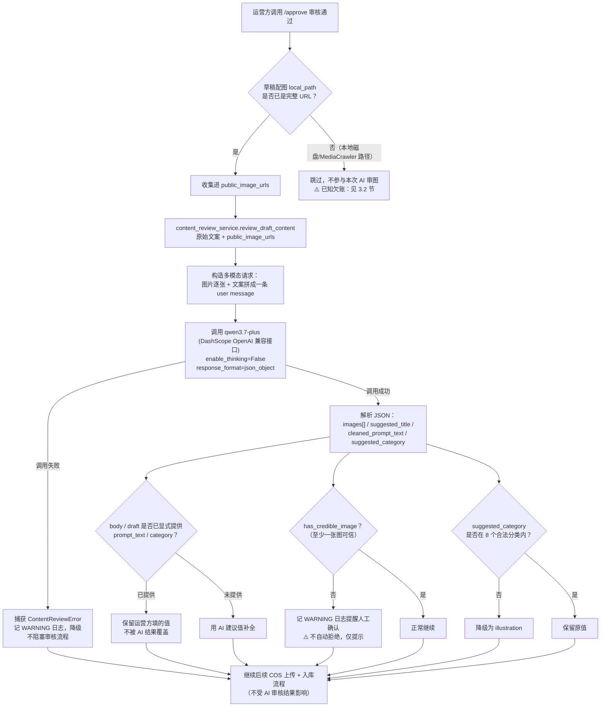

# AIGC提示词站 · 内容审核方案（AI 预审）

> 最后更新：2026-10-09
> 与爬虫方案的关系：本方案不属于采集流程本身，解决的是"采集到的草稿里混入非 AI 效果图、文案抄录自原帖不干净、分类未定"这三个结构性问题。采集阶段的技术原理见 `aigc-prompt-爬虫方案.md`；图片的云端存储见 `aigc-prompt-图片存储方案.md`。

---

## 一、要解决的问题

2026-10-09 批量审核通过 35 条采集数据并上线后，发现三类质量问题：

1. **封面图不是 AI 生成的效果图**：游戏官方截图、真人实拍照片、软件操作教程截图等，被当成"AI 效果图"直接发布
2. **文案是原帖的直接搬运**：带话题标签、互动语气、与图片效果无关的宣传语，不是干净的提示词正文
3. **分类未经判断**：草稿默认沿用旧的 7 分类字符串，或者直接为空

这三个问题的本质是：采集阶段"抓到即发布"，缺一道"内容是否可信、干净、归类正确"的审核环节。

## 二、方案选型

### 2.1 为什么是"单次结构化调用"而不是 Agent

审核任务的输入输出都是确定的（N 张图 + 1 段文案 → 固定 JSON 结构），不需要多轮工具调用或自主决策，用 Agent 循环只会增加延迟和成本，没有实际收益。所以选择最简单的方案：一次多模态 Chat Completion 调用，提示词里把输出格式约束清楚。

### 2.2 为什么是 qwen3.7-plus

- 阿里云百炼（DashScope）的多模态模型，支持一次请求传多张图 + 文本，走 OpenAI 兼容接口，用现成的 `openai` SDK 即可调用，不需要额外接入成本
- 相比 `qwen3-vl-plus`（当时文档显示"即将部分下线"），`qwen3.7-plus` 是更新的在售模型
- 价格在个人项目可承受范围内，经真实测试验证可用

### 2.3 为什么关闭 thinking 模式

`qwen3.7-plus` 默认开启思考模式，返回体里会带 `reasoning_content`，第一次真实调用测试时观察到额外消耗了约 97 token 的推理内容——分类判断这类任务不需要显式推理过程，所以显式传 `extra_body={"enable_thinking": False}` 关闭，省 token 和延迟。

## 三、技术实现

### 3.0 当前整体流程图

当前 `approve_draft` 里的实际执行顺序如下（含 3.2 节提到的"先审后传"权宜顺序，图中已标注）：



> 批量处理存量数据时（`scripts/apply_offline_review.py`）走的是另一条独立路径：不经过 `approve_draft`，直接对已发布过的 `Prompt` 记录重新跑 `review_draft_content`，审核通过后用结果覆盖字段、删除不可信图片、置 `is_published=True`，详见第四节。

### 3.1 核心代码

`app/services/content_review_service.py`：

```python
async def review_draft_content(
    raw_text: str,
    image_urls: list[str],
) -> ContentReviewResult:
    """对单条草稿进行 AI 预审，一次请求返回全部判断结果。"""
    client = _get_client()
    response = await client.chat.completions.create(
        model="qwen3.7-plus",
        messages=[
            {"role": "system", "content": _SYSTEM_PROMPT},
            {"role": "user", "content": _build_user_message(raw_text, image_urls)},
        ],
        response_format={"type": "json_object"},
        extra_body={"enable_thinking": False},
    )
    return _parse_response(response.choices[0].message.content, len(image_urls))
```

返回结构 `ContentReviewResult`：
- `images: list[ImageReviewResult]`——每张图的 `index`（对应入参顺序）、`is_credible`（是否判断为 AI 效果图）、`reason`（中文判断理由）
- `suggested_title`：8 字以内的清洗后标题
- `cleaned_prompt_text`：去掉话题标签、互动语气、无关 emoji 后的提示词正文
- `suggested_category`：8 个分类 key 之一（分类定义集中在 `app/routers/categories.py` 的 `CATEGORY_LABELS`，审核服务直接引用，不重复定义）

容错设计：
- 模型返回的分类不在合法范围内时，降级为 `illustration`，不让非法值进数据库
- 模型漏判某张图时，默认 `is_credible=True`（宁可漏判为可信，不误杀）
- 网络错误、JSON 解析失败统一包装成 `ContentReviewError`，由调用方决定是否降级（不阻塞主流程）

### 3.2 一个重要限制：图片必须是公网可访问的 URL

`qwen3.7-plus` 是通过 URL 下载图片，不接受本地文件或 base64。这带来两个连锁问题：

1. **草稿审核流程里的时序问题**：`approve_draft` 原本是"先 AI 审核、再 COS 上传"，但草稿图片这时还是本地路径或 MediaCrawler 临时目录，AI 服务下载不到。当前的权宜处理：只把草稿里已经是完整 URL 的图片（`image.local_path.startswith("http")`）传给 AI 审核，其余本地路径图片跳过审图（文案清洗和分类建议仍会执行）。**这是已知的技术欠账**，正确的时序应该是"先上传 COS 拿到公网 URL，再审核"，当前为了快速验证效果没有重排顺序，留作后续优化项。

2. **第三方 CDN 防盗链**：存量数据里一部分图片 `image_url` 直接复用了小红书 CDN 直链（`xhscdn.com`），这类链接有防盗链机制，`curl`/模型侧直接请求返回 403。解决方式见下节的 `migrate_remote_image_to_cos`。

### 3.3 和审核流程的集成

`app/services/crawl_service.py` 的 `approve_draft`，在"解析 models 字段"之后、"COS 上传图片"之前插入 AI 预审：

- 只把 `local_path` 已经是完整 URL 的图片传给 AI 审核
- 请求体里显式传了 `prompt_text` / `category` 时优先用请求体的值；都没传时才用 AI 建议值补全——避免运营方手动填好了又被 AI 悄悄覆盖
- 全部图片都被判定为不可信时，只打 `WARNING` 日志提醒人工确认，不拦截审核流程（审核结果是"建议"，不是"强制门禁"）

### 3.4 `cos_service.migrate_remote_image_to_cos`

为了让存量数据里的 xhscdn 直链图片也能被 AI 审核，给 `cos_service.py` 新增了一个函数：下载第三方 CDN 图片后转存到自己的 COS。

```python
async def migrate_remote_image_to_cos(remote_url: str) -> str:
    """下载第三方 CDN 图片，转存到 COS，返回新的公网 URL。"""
    headers = {
        "User-Agent": "Mozilla/5.0 ...",
        "Referer": "https://www.xiaohongshu.com/",  # 规避小红书防盗链
    }
    async with httpx.AsyncClient(timeout=30.0, follow_redirects=True) as client:
        resp = await client.get(remote_url, headers=headers)
        resp.raise_for_status()
    # 按 Content-Type 猜测扩展名后用 _upload_bytes_sync 转存
    ...
```

只带 `User-Agent` 不够（仍返回 403），补上 `Referer: https://www.xiaohongshu.com/` 之后才下载成功——这类防盗链校验的是请求来源页面，不是签名级别的防护。

## 四、存量数据批量处理（2026-10-09 真实执行记录）

### 4.1 背景

9 月已上线又因质量问题下线的 35 条数据，用这套新审核服务重新跑了一遍，决定哪些能恢复上线。

### 4.2 执行脚本

- `scripts/review_offline_prompts.py`：只读预览脚本，先把 35 条里还在 xhscdn 直链的图片迁移到 COS（149 张，全部成功），再逐条跑 AI 审核并打印结果，不改 `is_published` / `category` 等业务字段——用于人工先看效果再决定要不要应用
- `scripts/apply_offline_review.py`：确认预览效果后，正式应用的脚本。对每条数据重新跑一次审核（审核判断和写库动作在同一次调用里完成，不复用预览脚本的打印结果，避免人工复制粘贴出错）：
  - 至少一张图片可信：用 AI 建议覆盖 `title` / `prompt_text` / `category`，删除判定为不可信的 `PromptImage` 记录，`is_published` 置为 `True`
  - 全部图片不可信：保持 `is_published=False` 不动，留给人工复核

### 4.3 执行结果

- 149 张图片迁移 COS：成功 149，失败 0
- 35 条数据 AI 审核：**30 条重新上线**（标题/文案/分类已更新为 AI 清洗结果，内部逐张剔除了不可信图片），**5 条保持下线**
- 保持下线的 5 条（全部图片被判定为非 AI 效果图，没有可用素材可保留）：
  - 《一句话给头像带上圣诞帽》——图片是真实猫咪照片
  - 《手写励志文字壁纸背景图》——图片是真实风景摄影叠加文字
  - 《GPT-image2高审美生图提示词合集》——图片是"真实照片+水彩风格化处理"对比图，上半部分非 AI 生成
  - 《攀岩人像质感增强提示词》——图片是真实相机噪点的实拍照片
  - 《照片转纸胶带拼贴艺术提示词》——图片是真实宠物照片+手工拼贴，非 AI 生成
- 上线后分类分布（新 8 分类体系）：`portrait` 6、`workflow` 7、`poster` 5、`image_edit` 4、`avatar` 4、`photography` 2、`illustration` 1、`character` 1

## 五、已知局限 / 待办

- [ ] **审核时序欠账**：目前草稿审核时只能审"已经是公网 URL"的图片，本地路径的图片跳过审图。正确做法应该是调整 `approve_draft` 的步骤顺序：先 COS 上传拿到公网 URL，再送 AI 审核，而不是现在这种"先审后传"的权宜顺序。
- [ ] **审核是建议不是强制门禁**：目前全部图片不可信也不会自动拒绝草稿，只打日志提醒，后续如果运营量上升，可能需要加一个"全部不可信自动转 rejected 状态"的开关。
- [ ] **没有复核机制**：AI 判断一次就直接采信（存量批量处理场景），没有人工二次确认环节；如果后续发现误判率高，需要在 `approve_draft` 里加一个"AI 审核结果先存草稿字段，人工确认后才真正生效"的中间状态。
- [ ] **调用成本未监控**：目前没有记录每次调用的 token 消耗和费用，长期跑量后应该加日志统计。
